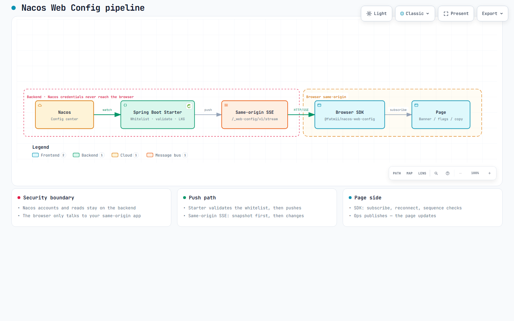

<h1 align="center">Nacos Web Config</h1>

<p align="center">
  <em>Let the browser safely receive only the Nacos JSON configs you allow. Change a config, and the page updates.</em>
</p>

<p align="center"><a href="./README.zh-CN.md">中文</a></p>

<p align="center">
  <a href="https://fatmii.github.io/nacos-web-config/"></a>
  &nbsp;
  <a href="https://github.com/FatMii/nacos-web-config/actions/workflows/verify.yml"></a>
  &nbsp;
  <a href="https://central.sonatype.com/artifact/io.github.fatmii.nacoswebconfig/nacos-web-config-spring-boot-starter"></a>
  &nbsp;
  <a href="https://www.npmjs.com/package/@fatmii/nacos-web-config"></a>
  &nbsp;
  <a href="./LICENSE"></a>
  &nbsp;
  <a href="#"></a>
  &nbsp;
  <a href="#"></a>
</p>

> **0.2.0** is on Maven Central and npm. The quick start below installs from those registries.

<p align="center">
  <a href="https://fatmii.github.io/nacos-web-config/architecture/pipeline.html">
    
  </a>
</p>

<p align="center">
  <a href="https://fatmii.github.io/nacos-web-config/architecture/pipeline.html"><strong>Open the interactive architecture diagram</strong></a>
  ·
  <a href="https://fatmii.github.io/nacos-web-config/en/#architecture">Embedded on the site</a>
</p>

<p align="center">
  
</p>

<p align="center"><em>Publish in Nacos — same-origin SSE pushes to the page (live recording)</em></p>

---

# Table of contents

- [What it is](#what-it-is)
- [Why you need it](#why-you-need-it)
- [Features](#features)
- [Quick start](#quick-start)
- [Local demo](#local-demo)
- [Configuration reference](#configuration-reference)
- [Operations (optional)](#operations-optional)
- [Behind a gateway or proxy](#behind-a-gateway-or-proxy)
- [Front-end dev server and framework wiring](#front-end-dev-server-and-framework-wiring)
- [Chinese content, and Windows](#chinese-content-and-windows)
- [Compatibility](#compatibility)
- [Limitations](#limitations)
- [Changelog](./CHANGELOG.md)
- [Security](#security)
- [License](#license)

---

# What it is

- A Spring Boot **starter** you add to an existing app (no extra service to run)
- A small **browser SDK** (TypeScript ESM, no runtime dependencies)
- A **read-only** path: the page only gets the JSON configs you explicitly allow

---

# Why you need it

Banners, feature flags, and campaign copy often live in Nacos. Ops wants the live page to change as soon as they publish—not after the next frontend release.

But the page should not talk to Nacos itself:

- **Do not put the password in the frontend.** Anyone can see it in DevTools. A stolen Nacos account can change or delete configs, not only read them.
- **You cannot open just one config.** Nacos authorizes by namespace: you cannot grant a page access to one config and leave the rest of the namespace alone.
- **Opening it to the public is risky.** Anyone can hammer it. If it goes down, every backend that depends on it is affected.

So let your Spring Boot app talk to Nacos, and let the page talk only to your app. You list which names the page may see; the backend checks them and pushes updates.

| Scenario | Homegrown polling API | nacos-web-config |
| --- | --- | --- |
| Who sees what | You write auth and mapping | **Only the names you list** |
| Ops publishes bad JSON | Rules are yours; the page often breaks | **Drop bad data; keep the last good value** |
| Show updates soon after publish | Keep polling, or build push yourself | **Backend pushes changes** |
| Nacos is briefly down | You invent the behavior | **Values on the page are not cleared** |
| Integration cost | Cache, protocol, tests | **One dependency, a few lines of YAML, one `subscribe()` call** |

---

# Features

## Only configs you allow

In YAML `exposures`, you map a page-facing name (like `ui`) to one Nacos config. The frontend subscribes by that name only. It never sees the Nacos address, group, or dataId.

You must also choose who can connect: `public` (anyone can read the allowed configs) or `authenticated` (signed-in users only). If you skip that, the app fails to start.

## Bad data does not break the page

Updates must be JSON objects under your size limit (`max-bytes`). Anything else is dropped, and the page keeps the last good value. Identical content is not pushed again.

## Push updates after publish

The backend pushes over SSE—no frontend polling timer. One connection can subscribe to up to 32 names. A full snapshot comes first, then later changes. If events arrive out of order, the SDK rejects them and refetches a full snapshot so the page does not drift.

## Survives disconnects and outages

If Nacos is temporarily unreachable, values on the page are not cleared. They are marked stale and refreshed when Nacos is back. The SDK reconnects on its own, and refreshes when a background tab becomes visible again. A slow browser only hurts its own connection.

---

# Quick start

### Prerequisites

- JDK 17+, Maven, Node.js (CI pins Temurin 17 / Node 22)
- A Spring Boot 3.x **servlet/MVC** application
- Nacos Server 2.5.3 (3.2.3 adapter-tested only; see [Compatibility](#compatibility))

### 1. Backend: add the starter and declare the whitelist

```xml
<dependency>
  <groupId>io.github.fatmii.nacoswebconfig</groupId>
  <artifactId>nacos-web-config-spring-boot-starter</artifactId>
  <version>0.2.0</version>
</dependency>
```

```yaml
# application.yml
nacos-web-config:
  enabled: true             # off unless explicitly enabled
  access: public            # required: public | authenticated
  nacos:
    server-addr: 127.0.0.1:8848
  exposures:                # whitelist: logical key -> fixed Nacos coordinates
    ui:
      group: WEB_DEMO
      data-id: web-demo.public.json
      max-bytes: 65536
```

This exposes the SSE endpoint at `/_web-config/v1/stream`. To change it, add a `path` entry under `nacos-web-config:` in `application.yml` (same level as `enabled` and `access`):

```yaml
nacos-web-config:
  path: /my-config-stream   # the stream then lives at /my-config-stream/v1/stream
```

**Choosing `access`**

- **`public`**: anyone who can reach the endpoint may read the whitelisted content (read-only, never the whole store). Use it for announcements strangers may see.
- **`authenticated`**: a stream opens only when the request already has a signed-in identity. The starter checks `request.getUserPrincipal()` and does not care which component set it (Spring Security, JWT/session filter, container auth). It never logs anyone in.
- If nothing sets a principal, every connection gets 401 (fail-closed).
- Access is per stream, not per key.

### 2. Frontend: subscribe

```bash
npm install @fatmii/nacos-web-config
```

```ts
import { createWebConfig } from '@fatmii/nacos-web-config'

const config = createWebConfig({
  endpoint: '/_web-config/v1/stream', // optional: the default value; pass it only after changing the starter's path
  definitions: {
    ui: { fallback: { announcement: '' } },
  },
})

const unsubscribe = config.subscribe('ui', state => {
  renderAnnouncement(state.value?.announcement ?? '')
})
// config.get('ui') reads current state without a network call;
// the shared connection opens on the first subscribe().
```

When your page needs stricter checks, add a `decode` guard. A rejected value keeps the last known good value, marks the key `invalid`, and surfaces via `onError` (or one `console.warn` per key if `onError` is absent):

```ts
ui: {
  fallback: { announcement: '' },
  // optional: without it, the server-validated JSON object passes through as-is
  decode(value) {
    if (typeof value !== 'object' || value === null) throw new Error('ui must be an object')
    return { announcement: String((value as { announcement?: unknown }).announcement ?? '') }
  },
},
```

---

# Local demo

You need **JDK 17**, **Maven**, and **Docker** that can run `linux/amd64` images (Docker Desktop, OrbStack, etc.). `dev-environment/start.ps1` is a maintainer helper pinned to the `desktop-linux` context — **it will not work on every machine**. Prefer Compose and only Nacos 2.5.3:

```powershell
cd dev-environment
docker compose --project-name nacos-web-config-local up -d nacos2
# wait until http://127.0.0.1:18848/nacos responds
```

Then start the reference host (port `18848`, not the usual `8848`):

```powershell
cd ..\java
$env:NACOS_SERVER_ADDR='127.0.0.1:18848'
mvn -pl examples/spring-mvc -am spring-boot:run
```

Open `http://127.0.0.1:8080/`, publish `web-demo.public.json` under group `WEB_DEMO` in the Nacos console (e.g. `{"announcement":"hello"}`). The page should update within a few seconds without a reload.

More detail: [`java/examples/spring-mvc/README.md`](./java/examples/spring-mvc/README.md) and [`dev-environment/README.md`](./dev-environment/README.md).

---

# Configuration reference

All keys sit under `nacos-web-config`. An invalid value **fails startup with a precise message**; nothing is silently defaulted. Full config with defaults below (`//` is documentation only — use `#` in real YAML):

```yaml
nacos-web-config:
  enabled: false                    // master switch; module is off unless true
  access: public                    // required: public | authenticated; see “Choosing access” above
  path: /_web-config                // base path; stream is <path>/v1/stream; must start with / and must not end with /

  exposures:                        // whitelist; at least one entry; alias /^[A-Za-z0-9][A-Za-z0-9._-]{0,63}$/
    ui:                             // page-facing name the SDK subscribes to; rename or add entries as needed
      data-id: web.ui.json          // required: fixed Nacos dataId behind this name
      group: DEFAULT_GROUP          // fixed Nacos group
      max-bytes: 65536              // per-value cap; oversized or non-JSON-object content is dropped; page keeps last good value

  nacos:
    server-addr: 127.0.0.1:8848     // required when the starter builds the client; host:port, comma-separated; omit if reusing an existing client
    namespace: public               // single namespace this instance serves
    username: ""                    // fill when Nacos auth is on; credentials stay on the backend
    password: ""
    timeout: 3s                     // timeout on Nacos client operations

  source:
    mode: auto                      // auto: reuse the only ConfigService bean, else build from nacos.* (fails if several beans); bean: reuse bean-name; managed: always build
    bean-name: ""                   // required when mode=bean: which ConfigService bean to reuse

  stream:                           // defaults fit small-to-medium traffic; tune at scale
    heartbeat: 15s                  // SSE ping interval
    connection-timeout: 30m         // server closes the stream after this; SDK reconnects and refetches a snapshot
    max-connections: 1000           // concurrent stream cap; excess gets 429
    max-keys-per-connection: 32     // max logical names per browser connection
    max-pending-bytes-per-connection: 1MB  // slow-consumer budget; over budget drops that connection only

  startup:
    fail-fast: false                // true: abort startup if whitelisted configs are unavailable; default boots and uses fallback/stale until Nacos is up
```

### Prefer aggregate keys

One logical key maps to one fixed Nacos config. Adding a key means editing `application.yml` and restarting: every widening of the public surface goes through a deploy and cannot be changed at runtime. Content that changes often needs no new key: expose one coarse key (e.g. `homepage`) and put the fields in its JSON body, and an ops edit goes live immediately. Split keys only on real boundaries: different access level, owner, or size budget.

---

# Operations (optional)

Nothing here is required to run the library. If your application uses Spring Boot Actuator, two
things appear with no code of your own. A host without Actuator is untouched: no endpoint, no extra
dependency, no startup requirement.

Turn it on by adding Spring's own Actuator starter — no version tag needed when you already import
the Spring Boot BOM, and nothing from this library is involved:

```xml
<dependency>
  <groupId>org.springframework.boot</groupId>
  <artifactId>spring-boot-starter-actuator</artifactId>
</dependency>
```

**Health** — `GET /actuator/health/nacosWebConfig`

```json
{
  "status": "UP",
  "details": {
    "source": "available",
    "exposures": {
      "ui": { "status": "ready", "hasValue": true }
    }
  }
}
```

`source` is whether Nacos is currently reachable, and only it turns this component DOWN. A rejected
or deleted config still serves its last-known-good value to browsers, so it shows up as a per-key
state (`ready` / `invalid` / `deleted` / `unavailable`, plus the stable error code) instead of
failing your readiness probe.

That `details` object is hidden by default: Actuator serves only the overall status (UP / DOWN)
until you opt in to details. Add this at the top level of `application.yml` (Spring Boot's own
`management` config, unrelated to `nacos-web-config`):

```yaml
# application.yml
management:
  endpoint:
    health:
      show-details: always   # details visible to everyone who can reach the health endpoint; when-authorized restricts it
```

With that in place, `/actuator/health` and `/actuator/health/nacosWebConfig` both return the JSON above.

**Metrics** — `GET /actuator/metrics/<name>`

Actuator's own default is to serve only `health` over HTTP, so the metric URLs below answer `404`
until you expose the `metrics` endpoint as well — with `include: health` we measured exactly that:

```yaml
# application.yml
management:
  endpoints:
    web:
      exposure:
        include: health,metrics
```

| Metric | What it tells you |
| --- | --- |
| `nacos.webconfig.stream.connections` | SSE streams currently open in this process |
| `nacos.webconfig.stream.events` | frames written to browsers, tagged `kind=snapshot`, `change`, `heartbeat` |
| `nacos.webconfig.rejections` | publishes the runtime refused, tagged by reason code (`INVALID_JSON`, `TOO_LARGE`) |

Counts are per process and reset on restart. No metric carries configuration content: a refused
publish is counted here, and its SHA-256 (never its body) goes to the
`io.github.fatmii.nacoswebconfig.REJECTIONS` logger. The bundled demo host runs Actuator, so
`java/examples/spring-mvc` shows both surfaces.

`stream.connections` is an upper bound: a stream whose client vanished is released only when the
next write to it fails — a heartbeat or a push — so it keeps counting for a moment after the browser
disappears. In our runs it settled within about one heartbeat interval; refresh before you trust it.

---

# Behind a gateway or proxy

The stream is one long-lived `text/event-stream` response per browser. Two things gateways
normally "optimise" will bite it: an idle read timeout, and a rewritten `Host` header.

Check any gateway in one command, from the origin your browser uses:

```bash
curl -N -H 'Accept: text/event-stream' 'https://your-host/_web-config/v1/stream?key=ui'
```

You should get `event:snapshot` immediately, then a `:ping` comment no later than
`nacos-web-config.stream.heartbeat` (15s by default). Silence longer than the heartbeat means
something in between is holding the stream.

Measured against Nginx 1.28 in front of the bundled demo host — every number below is one run,
publish to first byte at the client:

| Gateway setting | Observed |
| --- | --- |
| `proxy_read_timeout 5s`, default `heartbeat: 15s` | the gateway closed the idle stream after ~5s. The SDK marked the key `unavailable` while keeping the previous value on screen, came back to `ready` within ~1.4s, and both configs published during the run still arrived. No `onError` fired |
| `proxy_read_timeout 5s`, `heartbeat: 2s` | the stream stayed open for the whole 14s probe window |
| `proxy_buffering on` vs `off`, with and without `proxy_ignore_headers X-Accel-Buffering` | 72–150 ms in all four variants: the starter already sends `X-Accel-Buffering: no` and `Cache-Control: no-store`, and nginx honoured them. `proxy_buffering off` is still what we recommend, but we could not reproduce a buffering delay to call it required |
| `gzip on` including `text/event-stream` | 122 ms, no extra delay measured |
| no `proxy_http_version 1.1` (plain HTTP/1.0 to the upstream) | 107 ms; we did not reproduce a problem either |
| `proxy_set_header Host $host` | **broken**: a Spring Security login redirect dropped the port — `Location: http://127.0.0.1/login`. With `proxy_set_header Host $http_host` the same request returned `http://127.0.0.1:18089/login` |

So the two settings that actually matter are `proxy_read_timeout` (keep it above your heartbeat
interval) and `Host` (use `$http_host` if the host application issues redirects). The response
headers the starter emits pass through untouched: `Content-Type: text/event-stream`,
`Cache-Control: no-store`, `X-Accel-Buffering: no`.

`dev-environment/proxy/nginx.conf` is the configuration CI runs the browser suite against, and
`access: authenticated` behaves the same behind it: anonymous `Accept: text/event-stream` gets
`401` with a JSON body, `Accept: text/html` gets the `302` login redirect, and an authenticated
request receives its `event:snapshot`.

We measured nginx only. Cloud balancers, CDNs, HTTP/2 and dev-server proxies (Vite and friends)
are not covered by these numbers — run the curl check above before trusting one.

---

# Front-end dev server and framework wiring

The SDK always requests the same origin that served the page, so a local dev server only has to
forward `/_web-config`:

```js
// vite.config.js
import { defineConfig } from 'vite'

export default defineConfig({
  server: {
    proxy: { '/_web-config': { target: 'http://127.0.0.1:8080' } },
  },
})
```

Nothing else is needed for the stream. Measured with Vite 8.3.4 in front of the bundled demo host:
a config publish reached the client in 73–158 ms — the same as talking to the backend directly — and
the stream stayed uncompressed even though Vite enables `server.compress` by default. Two
properties of Vite worth knowing before you chase a phantom bug:

- It listens on the IPv6 loopback only (`[::1]:5173`). `http://localhost:5173` works,
  `http://127.0.0.1:5173` gets no answer. Open it as `localhost`, or set `server.host`.
- A production build does not proxy anything. Ship the built files and the endpoint under the same
  origin, or point the client elsewhere with the `endpoint` option.

React and Vue wiring — both rendered in a real browser against the demo host and `vite build`-checked
(React 19.3, Vue 3.5.44, the published `@fatmii/nacos-web-config` 0.1.0):

```jsx
import { useEffect, useState } from 'react'
import { createWebConfig } from '@fatmii/nacos-web-config'

const config = createWebConfig({
  definitions: { ui: { fallback: { text: 'Announcements off' } } },
})

export function Announcement() {
  const [ui, setUi] = useState(() => config.get('ui'))
  useEffect(() => config.subscribe('ui', setUi), [])
  return <p>{ui.value?.text}</p>
}
```

```vue
<script setup>
import { onUnmounted, shallowRef } from 'vue'
import { createWebConfig } from '@fatmii/nacos-web-config'

const config = createWebConfig({
  definitions: { ui: { fallback: { text: 'Announcements off' } } },
})
const ui = shallowRef(config.get('ui'))
onUnmounted(config.subscribe('ui', (next) => { ui.value = next }))
</script>

<template>
  <p>{{ ui.value?.text }}</p>
</template>
```

Both keep the client at module level, so the whole page shares one stream and every component
subscribes to it. The two teardown calls do different jobs. The function returned by `subscribe()`
removes only that listener, so unmounting a component never drops the shared stream. Call
`config.close()` when the whole view goes away: it aborts the stream, clears timers, drops all
listeners, and is idempotent; `subscribe()` afterwards throws `CLIENT_CLOSED`.

---

# Chinese content, and Windows

Chinese values are safe end to end: publish `{"banner":{"text":"系统将于今晚 23:30 维护"}}` and the browser
receives those bytes untouched — the stream is UTF-8, and neither the client nor the SDK needs any
charset setting. Verified against Nacos 2.5.3.

What bites is the publishing step on Windows. Passing Chinese inline on the command line was measured
to store **non-UTF-8 bytes** in Nacos:

```bash
# don't do this from Git Bash on Windows with Chinese inline
curl -X POST http://127.0.0.1:8848/nacos/v1/cs/configs \
  -d 'dataId=web-demo.public.json' -d 'group=WEB_DEMO' \
  --data-urlencode 'content={"banner":{"text":"内联中文测试"}}'
```

The damaged value is still a syntactically valid JSON object, so the whitelist's content check does
not reject it: we read back bytes that are not valid UTF-8 and the stream kept serving that key with
`status: ready`. Nothing in the chain stops it, so the page is handed whatever the browser makes of
those bytes. Publish from a UTF-8 file instead:

```bash
# content@ needs a Windows path here: the curl that ships with Windows cannot read /tmp/... paths
curl -X POST http://127.0.0.1:8848/nacos/v1/cs/configs \
  --data-urlencode 'dataId=web-demo.public.json' \
  --data-urlencode 'group=WEB_DEMO' \
  --data-urlencode 'content@D:/configs/web-demo.public.json'
```

A `decode` guard is the cheap backstop for this class of mistake: throw on a value that cannot be
real (a text containing U+FFFD, a length that is too short, an unexpected character class) and the
runtime keeps the last known good value instead of showing mojibake.

If the console prints garbage, that alone does not prove the stored value is broken — read it back and
decode it as UTF-8 before you start fixing the wrong side.

---

# Compatibility

| Dependency | Version | Notes |
| --- | --- | --- |
| Java | 17+ | Spring Boot 3.x, servlet/MVC |
| Nacos client | 2.5.3 | single supported client line |
| Nacos server | 2.5.3 | full chain verified (Java IT + browser E2E; nightly CI) |
| Nacos server | 3.2.3 | full chain verified (Java IT + browser E2E; nightly CI; Admin token via `dev-environment/scripts/fetch-nacos3-admin-token.mjs`) |
| Browsers | modern | `fetch` + `ReadableStream`; no EventSource fallback |

### Who decides which versions end up in your application

We do not. Measured with a throwaway consumer that imports `spring-boot-dependencies` 3.5.16 and
adds only this starter:

| Artifact | Resolved in that consumer | Pinned in our own build |
| --- | --- | --- |
| `jackson-databind` | `2.21.4` — your BOM's choice | `2.21.7` |
| `tomcat-embed-core` | `10.1.55` — your BOM's choice | `10.1.60` |
| `spring-webmvc` | `6.2.19` — your BOM's choice | `6.2.19` |
| `com.alibaba.nacos:nacos-client` | `2.5.3` — ours; nothing else manages it | `2.5.3` |

The versions we ahead-pin in our parent pom (the reasons are commented there, mostly
security advisories) protect our build and CI. They do not travel into your dependency tree, so if
you want them, manage them yourself. Your `dependencyManagement` applies in both directions:
importing `jackson-bom` `2.19.0` in that same consumer produced `jackson-databind:2.19.0`, a
downgrade, without any warning. To see what your own build actually resolves, run:

```bash
mvn -Dincludes='com.fasterxml.jackson.core:*,org.apache.tomcat.embed:*' dependency:tree
```

`nacos-client` is the only third-party version we bring with us. If your application already uses
the Nacos client, keep one version in your own dependency management; `2.5.3` is the line this
library is tested against.

---

# Limitations

- Servlet MVC only; no WebFlux.
- Values must be JSON objects under `max-bytes`.
- ESM-only SDK; older browsers need your own bundler/polyfill.
- No admin UI; create and edit configs in the Nacos console.
- Whitelist keys are fixed at startup; adding a key means editing config and restarting.

---

# Security

Vulnerability reporting and the product security model: [SECURITY.md](SECURITY.md).
Do not file public issues for security problems.

---

# License

[Apache License 2.0](./LICENSE). Third-party notices in [NOTICE](./NOTICE).
