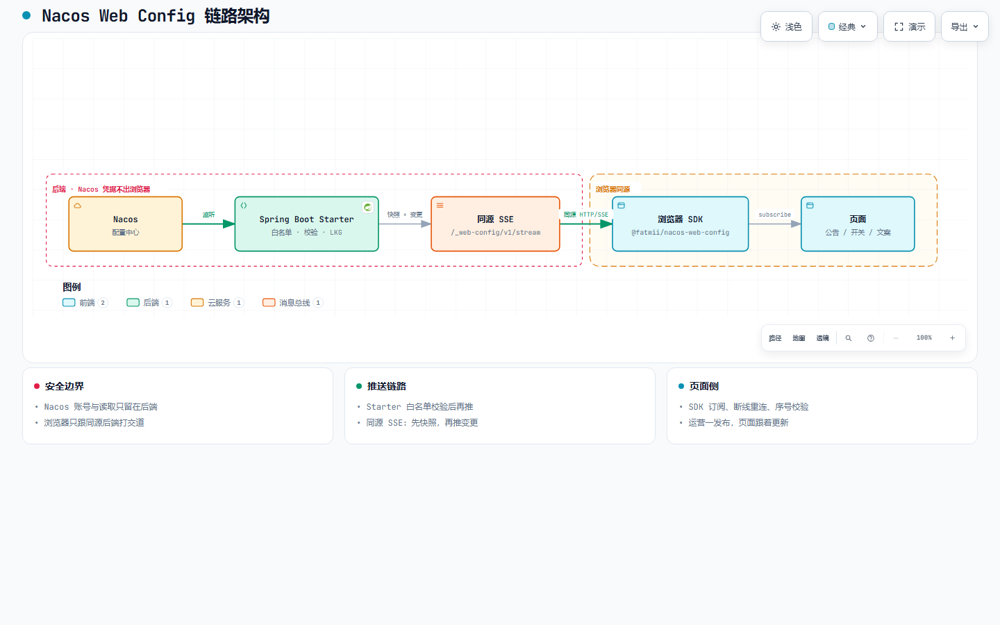
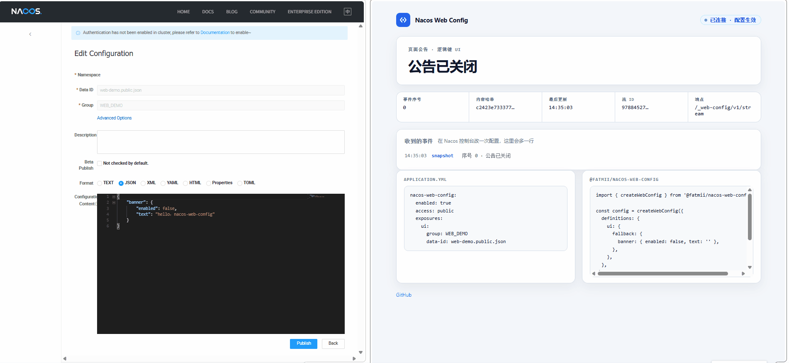

<h1 align="center">Nacos Web Config</h1>

<p align="center">
  <em>让网页安全地拿到 Nacos 里指定的 JSON 配置，配置一改，页面跟着更新。</em>
</p>

<p align="center"><a href="./README.md">English</a></p>

<p align="center">
  <a href="https://fatmii.github.io/nacos-web-config/"></a>
  &nbsp;
  <a href="https://github.com/FatMii/nacos-web-config/actions/workflows/verify.yml"></a>
  &nbsp;
  <a href="https://central.sonatype.com/artifact/io.github.fatmii.nacoswebconfig/nacos-web-config-spring-boot-starter"></a>
  &nbsp;
  <a href="https://www.npmjs.com/package/@fatmii/nacos-web-config"></a>
  &nbsp;
  <a href="./LICENSE"></a>
  &nbsp;
  <a href="#"></a>
  &nbsp;
  <a href="#"></a>
</p>

> **0.1.0** 已在 Maven Central 与 npm 发布。下面的快速开始从公共仓库安装。

<p align="center">
  <a href="https://fatmii.github.io/nacos-web-config/architecture/pipeline.zh-CN.html">
    
  </a>
</p>

<p align="center">
  <a href="https://fatmii.github.io/nacos-web-config/architecture/pipeline.zh-CN.html"><strong>打开交互架构图</strong></a>
  ·
  <a href="https://fatmii.github.io/nacos-web-config/#architecture">官网嵌入版</a>
</p>

<p align="center">
  
</p>

<p align="center"><em>Nacos 一点发布，同源 SSE 推到页面（真实录屏）</em></p>

---

# 目录

- [它是什么](#它是什么)
- [为什么需要它](#为什么需要它)
- [核心特性](#核心特性)
- [快速开始](#快速开始)
- [本地演示](#本地演示)
- [配置参考](#配置参考)
- [运维（可选）](#运维可选)
- [网关与反向代理](#网关与反向代理)
- [前端开发代理与框架接法](#前端开发代理与框架接法)
- [中文内容与 Windows](#中文内容与-windows)
- [兼容性](#兼容性)
- [局限](#局限)
- [Changelog](./CHANGELOG.zh-CN.md)
- [安全](#安全)
- [许可证](#许可证)

---

# 它是什么

- 装进现有 Spring Boot 应用的 **starter**（不用再起一个服务）
- 一个很小的**前端 SDK**（TypeScript ESM，没有运行时依赖）
- 一条**只读**通道：网页只能拿到你事先允许的那些 JSON 配置

---

# 为什么需要它

页面上的公告、功能开关、活动文案，经常存在 Nacos 里。运营一点发布，就希望线上页面跟着变，而不是等下一次前端发版。

但网页不该自己去连 Nacos：

- **账号不能写进前端。** 开发者工具里谁都能看到。拿到 Nacos 账号的人不只会读，还能改、删。
- **没法只放开一条配置。** Nacos 按命名空间授权。你没法说：网页只能看这一条，同命名空间别的一律不准碰。
- **直接对外很危险。** 谁都能打的话，配置中心容易被刷挂；一挂，依赖它的后端都会受影响。

所以还是让你的 Spring Boot 去连 Nacos，网页只连自己的后端。你在配置里写清楚哪些名字可以给网页看，后端校验后再推过去。

| 场景 | 自己写定时接口 | nacos-web-config |
| --- | --- | --- |
| 谁能看到什么 | 鉴权、映射都自己写 | **只放出你点名的那些名字** |
| 运营推了坏内容 | 规则自己定，页面容易直接挂 | **丢掉坏数据，继续用上一份好的** |
| 发布后要尽快出现在页面 | 继续轮询，或自己做推送 | **后端直接推变更** |
| Nacos 临时挂了 | 自己约定怎么表现 | **不把页面上的值清掉** |
| 接入成本 | 缓存、协议、测试都自己扛 | **依赖 + 一段 YAML + `subscribe()`** |

---

# 核心特性

## 只能看到你允许的配置

在 YAML 的 `exposures` 里写明：网页用的名字（比如 `ui`）对应 Nacos 里哪一条配置。前端只按这个名字订阅，看不到 Nacos 的地址、group、dataId。

还必须写明谁能连：`public`（谁都能读这些允许的配置）或 `authenticated`（只有已登录用户）。不写清楚，应用直接启动失败。

## 坏数据不会弄挂页面

推过来的内容必须是 JSON 对象，并且不能超过你设的大小（`max-bytes`）。不合格的内容会被丢掉，页面继续用上一份正常数据。内容完全没变时，也不会重复推。

## 发布后直接推到页面

后端用 SSE 推送变更，不用前端定时拉取。一条连接最多同时订 32 个名字；先发完整快照，再发之后的改动。顺序乱了前端会拒绝，然后重新拉一份完整数据，避免页面状态错乱。

## 断线、故障也能撑住

Nacos 暂时连不上时，不会把页面上的值清掉，只是标成过期，通了再自动读回来。前端断线会自动重试；标签页从后台切回来时，也会马上刷新。某个浏览器特别慢时，只影响它自己，不会拖垮其他人。

---

# 快速开始

### 前置条件

- JDK 17+、Maven、Node.js（CI 固定 Temurin 17 / Node 22）
- Spring Boot 3.x **Servlet/MVC** 应用
- Nacos Server 2.5.3（3.2.3 适配层测过，见[兼容性](#兼容性)）

### 1. 后端：引入 starter 并声明白名单

```xml
<dependency>
  <groupId>io.github.fatmii.nacoswebconfig</groupId>
  <artifactId>nacos-web-config-spring-boot-starter</artifactId>
  <version>0.1.0</version>
</dependency>
```

```yaml
# application.yml
nacos-web-config:
  enabled: true             # 默认关闭，须显式启用
  access: public            # 必填：public 或 authenticated
  nacos:
    server-addr: 127.0.0.1:8848
  exposures:                # 白名单：逻辑 key -> 固定 Nacos 坐标
    ui:
      group: WEB_DEMO
      data-id: web-demo.public.json
      max-bytes: 65536
```

启动后暴露 SSE 端点 `/_web-config/v1/stream`（可用 `path` 修改）。

**`access` 怎么选**

- **`public`**：能访问端点的人都能读白名单配置（只读，读不到整库）。适合陌生人可见的公告。
- **`authenticated`**：请求上已有登录身份才允许接流。Starter 只检查 `request.getUserPrincipal()` 是否非空，不问身份由谁挂上（Spring Security、自写 JWT/session 过滤器、容器认证均可），自己从不登录。
- 应用里若没有任何组件设置身份，一律 401（故意关死）。
- 级别是整条流一个，不能逐键设置。

### 2. 前端：订阅

```bash
npm install @fatmii/nacos-web-config
```

```ts
import { createWebConfig } from '@fatmii/nacos-web-config'

const config = createWebConfig({
  // endpoint 可省略（默认 '/_web-config/v1/stream'）；decode 可省略
  definitions: {
    ui: { fallback: { announcement: '' } },
  },
})

const unsubscribe = config.subscribe('ui', state => {
  renderAnnouncement(state.value?.announcement ?? '')
})
// config.get('ui') 只读当前状态，不发网络请求；首次 subscribe() 才建立共享连接。
```

页面要求更严时，给键加 `decode`：不合格值被拒收，保持最近有效值，键标为 `invalid`，经 `onError` 上报（未提供时每个键 `console.warn` 一次）：

```ts
ui: {
  fallback: { announcement: '' },
  decode(value) {
    if (typeof value !== 'object' || value === null) throw new Error('ui must be an object')
    return { announcement: String((value as { announcement?: unknown }).announcement ?? '') }
  },
},
```

---

# 本地演示

需要本机已有 **JDK 17、Maven**，以及能跑 `linux/amd64` 镜像的 **Docker**（Docker Desktop / OrbStack 等）。`dev-environment/start.ps1` 面向维护者本机（固定 `desktop-linux` 上下文），**不保证**在每台机器上都能直接跑通；更稳妥的做法是只用 Compose 起 Nacos 2.5.3：

```powershell
cd dev-environment
docker compose --project-name nacos-web-config-local up -d nacos2
# 等控制台可打开：http://127.0.0.1:18848/nacos
```

再启动参考宿主（注意端口是 `18848`，不是默认的 `8848`）：

```powershell
cd ..\java
$env:NACOS_SERVER_ADDR='127.0.0.1:18848'
mvn -pl examples/spring-mvc -am spring-boot:run
```

打开 `http://127.0.0.1:8080/`，在 Nacos 控制台的 `WEB_DEMO` 组发布 `web-demo.public.json`（例如 `{"announcement":"hello"}`）。页面应在数秒内更新，无需刷新。

更细的说明见 [`java/examples/spring-mvc/README.md`](./java/examples/spring-mvc/README.md) 与 [`dev-environment/README.md`](./dev-environment/README.md)。

---

# 配置参考

所有项都在 `nacos-web-config` 前缀下。非法值会让应用**启动失败并给出精确报错**，不会悄悄给默认值。下面是一份带默认值的完整配置（`//` 仅作说明，真正 YAML 请改用 `#`）：

```yaml
nacos-web-config:
  enabled: false                    // 总开关；不写 true 模块不工作
  access: public                    // 必填：public | authenticated，见快速开始「access 怎么选」
  path: /_web-config                // 端点前缀，推送流为 <path>/v1/stream；须 / 开头、不能以 / 结尾

  exposures:                        // 白名单，至少一条；别名规则 ^[A-Za-z0-9][A-Za-z0-9._-]{0,63}$
    ui:                             // 前端订阅用的逻辑名，可按需改名或增删
      data-id: web.ui.json          // 必填：这条配置对应的 Nacos dataId
      group: DEFAULT_GROUP          // 对应的 Nacos group
      max-bytes: 65536              // 单条上限；超限或非 JSON 对象会被丢掉，页面继续用上一份好的

  nacos:
    server-addr: 127.0.0.1:8848     // starter 自建客户端时必填，host:port，可逗号分隔多个；复用现有客户端时可省略
    namespace: public               // 本实例服务的唯一 namespace
    username: ""                    // Nacos 开启鉴权时填写；凭据只留在后端
    password: ""
    timeout: 3s                     // Nacos 客户端操作超时

  source:
    mode: auto                      // auto：恰有一个 ConfigService bean 就复用，否则用 nacos.* 自建（多个 bean 时报错）；bean：复用 bean-name；managed：总是自建
    bean-name: ""                   // mode=bean 时必填，要复用的 ConfigService bean 名

  stream:                           // 默认面向小中型流量，大规模再调
    heartbeat: 15s                  // SSE 心跳间隔
    connection-timeout: 30m         // 服务端到点关流；SDK 会自动重连并再取快照
    max-connections: 1000           // 同时在线流上限；超出回 429
    max-keys-per-connection: 32     // 单连接最多订阅几个逻辑名
    max-pending-bytes-per-connection: 1MB  // 慢客户端积压预算；超限只掐断该连接

  startup:
    fail-fast: false                // true：启动时拿不到白名单配置则失败；默认应用照常起，页面先用兜底/旧值
```

### 键怎么划分：优先聚合键

一个逻辑键对应一条固定 Nacos 配置；新增键要改 `application.yml` 并重启，对外可见范围每次扩大都留部署痕迹。高频改动的内容不必新键：暴露一个粗粒度键（如 `homepage`），字段放进那条 JSON，运营改一条即时生效。只在真实边界拆键：访问级别、负责人、大小预算不同。

---

# 运维（可选）

用这个库不需要任何运维配置。如果你的应用在用 Spring Boot Actuator，下面两样会自动出现，不用写一行代码。没装 Actuator 的应用完全不受影响：没有端点、不多依赖、不影响启动。

打开方式就是加 Spring 官方的 Actuator 起步依赖（不需要写版本号，也不需要本库做任何配合）：

```xml
<dependency>
  <groupId>org.springframework.boot</groupId>
  <artifactId>spring-boot-starter-actuator</artifactId>
</dependency>
```

**健康检查** —— `GET /actuator/health/nacosWebConfig`

```json
{"status":"UP",
 "details":{"source":"available",
            "exposures":{"ui":{"status":"ready","hasValue":true}}}}
```

`source` 表示当前连不连得上 Nacos，也只有它会把这个组件判成 DOWN。内容被拒或被删掉时，浏览器仍在收上一次的有效值，所以这类情况只作为每个键各自的状态列出来（`ready` / `invalid` / `deleted` / `unavailable`，附稳定错误码），不会把应用的就绪探针搞失败。Actuator 默认隐藏这些细节，要看到它们需要配 `management.endpoint.health.show-details=always`。

**指标** —— `GET /actuator/metrics/<名称>`

Actuator 出厂默认只把 `health` 开放成 HTTP 端点，所以下面这些指标地址在你暴露 `metrics` 之前都是 404（实测过：只配 `include: health` 时指标地址返回 404）：

```yaml
# application.yml
management:
  endpoints:
    web:
      exposure:
        include: health,metrics
```

| 指标 | 说明 |
| --- | --- |
| `nacos.webconfig.stream.connections` | 本进程当前挂着多少条 SSE 长连接 |
| `nacos.webconfig.stream.events` | 写给浏览器的帧数，按类型打标：`kind=snapshot`、`change`、`heartbeat` |
| `nacos.webconfig.rejections` | 被拒的发布次数，按原因码打标（`INVALID_JSON`、`TOO_LARGE`） |

计数只统计当前进程，重启归零。任何指标都不带配置内容：一次被拒的发布在这里只有一个计数，它的 SHA-256（绝不包含原文）进 `io.github.fatmii.nacoswebconfig.REJECTIONS` 日志。仓库自带的示例应用装了 Actuator，`java/examples/spring-mvc` 两样都能看到。

`stream.connections` 是一个上界：客户端已经消失的流，要等服务端下一次往它写东西（心跳或推送）失败才会被放掉，所以浏览器关掉后这个数字还会多算一小会儿。我们这几轮实测大约在一个心跳周期内回落；看它之前先刷一次。

---

# 网关与反向代理

推送通道是每个浏览器一条长期的 `text/event-stream` 响应。网关里最常"帮你优化"的两件事会咬到它：空闲读超时，以及被改写的 `Host` 头。

一条命令就能自查任意网关（用浏览器实际访问的那个域名）：

```bash
curl -N -H 'Accept: text/event-stream' 'https://你的域名/_web-config/v1/stream?key=ui'
```

应当立刻收到 `event:snapshot`，之后最长每隔 `nacos-web-config.stream.heartbeat`（默认 15s）收到一条 `:ping` 注释。安静超过一个心跳周期，就说明中间有个东西把流憋住了。

下面是把仓库自带示例应用放在 Nginx 1.28 后面实测的结果，每一行数字都是一次"发布配置 → 客户端收到第一个字节"的实测值：

| 网关配置 | 实测结果 |
| --- | --- |
| `proxy_read_timeout 5s` + 默认 `heartbeat: 15s` | 网关在 ~5s 空闲后把连接关掉。SDK 把该键标成 `unavailable`、页面上仍保留上一次的值，~1.4s 内回到 `ready`，这一轮里发布的两份配置都照样送达，`onError` 一次都没触发 |
| `proxy_read_timeout 5s` + `heartbeat: 2s` | 整段 14s 探测窗口内连接一直没断 |
| `proxy_buffering` 开 / 关，以及加不加 `proxy_ignore_headers X-Accel-Buffering` | 四种组合都是 72–150ms：starter 本来就发 `X-Accel-Buffering: no` 和 `Cache-Control: no-store`，nginx 照做了。`proxy_buffering off` 我们仍然推荐，但**没能复现出缓冲延迟，所以不敢写成必须** |
| `gzip on` 且包含 `text/event-stream` | 122ms，没测出额外延迟 |
| 不写 `proxy_http_version 1.1`（用 HTTP/1.0 回源） | 107ms，同样没复现出问题 |
| `proxy_set_header Host $host` | **会坏**：Spring Security 的登录跳转把端口丢了 —— `Location: http://127.0.0.1/login`。改成 `proxy_set_header Host $http_host` 后同一请求返回 `http://127.0.0.1:18089/login` |

所以真正要紧的只有两项：`proxy_read_timeout` 要大于你的心跳间隔；如果宿主应用会发跳转，`Host` 要用 `$http_host`。starter 发出的响应头能原样穿过网关：`Content-Type: text/event-stream`、`Cache-Control: no-store`、`X-Accel-Buffering: no`。

`dev-environment/proxy/nginx.conf` 就是 CI 跑浏览器用例时用的那份配置。`access: authenticated` 在网关后面的表现和直连一致：匿名带 `Accept: text/event-stream` 拿到 `401` 和 JSON 错误体，`Accept: text/html` 拿到 `302` 登录跳转，登录后正常收到 `event:snapshot`。

以上只测了 nginx。云负载均衡、CDN、HTTP/2、以及本地开发代理（Vite 这类）都不在这些数字的覆盖范围内 —— 用上面那条 curl 先在自己网关上验一遍再依赖它。

---

# 前端开发代理与框架接法

SDK 永远请求"把页面发出来的那个源"，所以本地开发服务器只要转发 `/_web-config` 就够：

```js
// vite.config.js
import { defineConfig } from 'vite'

export default defineConfig({
  server: {
    proxy: { '/_web-config': { target: 'http://127.0.0.1:8080' } },
  },
})
```

这条流不需要别的开关。用 Vite 8.3.4 挡在自带示例应用前面实测：发布一次配置到客户端收到，用时 73–158ms，和直连后端一样快；Vite 默认开着 `server.compress`，流也没被压。两点 Vite 自己的特性，先知道省得误判成 bug：

- 它只监听 IPv6 回环地址（`[::1]:5173`）。`http://localhost:5173` 打得开，`http://127.0.0.1:5173` 无响应。要用 `localhost` 打开，或者自己设 `server.host`。
- 打包后的产物不带任何代理。把静态文件和接口部署到同一个源，或者用 `endpoint` 选项指向别的源。

React 与 Vue 的接法如下 —— 两段都在真实浏览器里对着示例应用渲染过，也过了 `vite build`（React 19.3、Vue 3.5.44、npm 上已发布的 `@fatmii/nacos-web-config` 0.1.0）：

```jsx
import { useEffect, useState } from 'react'
import { createWebConfig } from '@fatmii/nacos-web-config'

const config = createWebConfig({
  definitions: { ui: { fallback: { text: '公告已关闭' } } },
})

export function Announcement() {
  const [ui, setUi] = useState(() => config.get('ui'))
  useEffect(() => config.subscribe('ui', setUi), [])
  return <p>{ui.value?.text}</p>
}
```

```vue
<script setup>
import { onUnmounted, shallowRef } from 'vue'
import { createWebConfig } from '@fatmii/nacos-web-config'

const config = createWebConfig({
  definitions: { ui: { fallback: { text: '公告已关闭' } } },
})
const ui = shallowRef(config.get('ui'))
onUnmounted(config.subscribe('ui', (next) => { ui.value = next }))
</script>

<template>
  <p>{{ ui.value?.text }}</p>
</template>
```

两段都把客户端放在模块顶层，这是故意的：一个页面共用一条流，页面上所有组件都从它取值。两种"收尾"要分清楚 —— `subscribe()` 返回的函数**只摘掉你自己这个监听**，组件卸载不会动那条共用的流；整块视图真的不要了才调 `config.close()`，它会断流、清定时器、丢掉所有监听，可重复调用（之后再 `subscribe()` 抛 `CLIENT_CLOSED`）。

---

# 中文内容与 Windows

中文值端到端是安全的：发布 `{"banner":{"text":"系统将于今晚 23:30 维护"}}`，浏览器拿到的就是这几个字节 —— 流本身是 UTF-8，客户端和 SDK 都不用设字符集。已在 Nacos 2.5.3 上实测。

会咬人的是"发布"这一步，尤其在 Windows 上。实测在命令行里内联传中文，Nacos 存下的是**非 UTF-8 字节**：

```bash
# Windows 的 Git Bash 里不要这样内联中文
curl -X POST http://127.0.0.1:8848/nacos/v1/cs/configs \
  -d 'dataId=web-demo.public.json' -d 'group=WEB_DEMO' \
  --data-urlencode 'content={"banner":{"text":"内联中文测试"}}'
```

坏掉的内容在语法上仍是合法 JSON 对象，白名单的内容校验不会拦：我们读回来的是非法 UTF-8 字节，而这条流一直把它当 `status: ready` 推出去。链路上没有任何一环会挡下来，页面只能拿到浏览器自行解释的结果。所以改成从 UTF-8 文件发布：

```bash
# content@ 后面这里必须给 Windows 路径：Windows 自带的 curl 读不到 /tmp/... 这种路径
curl -X POST http://127.0.0.1:8848/nacos/v1/cs/configs \
  --data-urlencode 'dataId=web-demo.public.json' \
  --data-urlencode 'group=WEB_DEMO' \
  --data-urlencode 'content@D:/configs/web-demo.public.json'
```

`decode` 是这类失误最便宜的兜底：对不可能是真的值直接抛错（含 U+FFFD 替换符的文本、短得不合常理、出现了不该有的字符），运行时就会保留上一次的有效值，而不是把乱码显示出去。

控制台显示乱码，不代表服务端存的也坏了 —— 先把内容 GET 回来按 UTF-8 解一次，再决定去修哪一边。

---

# 兼容性

| 依赖 | 版本 | 说明 |
| --- | --- | --- |
| Java | 17+ | Spring Boot 3.x，Servlet/MVC |
| Nacos Client | 2.5.3 | 唯一支持的客户端线 |
| Nacos Server | 2.5.3 | 完整链路实测（Java IT + browser E2E；夜间 CI） |
| Nacos Server | 3.2.3 | 完整链路实测（Java IT + browser E2E；夜间 CI；Admin token 用 `dev-environment/scripts/fetch-nacos3-admin-token.mjs`） |
| 浏览器 | 现代浏览器 | 需 `fetch` + `ReadableStream`，无 EventSource 回退 |

### 最终装进你应用的那些版本，谁说了算

不是我们。用一个只导入 `spring-boot-dependencies` 3.5.16、再加本库 starter 的一次性消费者工程实测：

| 构件 | 该消费者实际解析到 | 我们自己构建里钉的 |
| --- | --- | --- |
| `jackson-databind` | `2.21.4`（听你的 BOM） | `2.21.7` |
| `tomcat-embed-core` | `10.1.55`（听你的 BOM） | `10.1.60` |
| `spring-webmvc` | `6.2.19`（听你的 BOM） | `6.2.19` |
| `com.alibaba.nacos:nacos-client` | `2.5.3`（我们的，没有别人管它） | `2.5.3` |

我们在父 pom 里提前钉的那些版本（原因写在父 pom 的注释里，多数是安全公告）只保护我们自己的构建和 CI，**不会传进你的依赖树**；想要就在你自己的工程里管理。而且你的 `dependencyManagement` 两个方向都赢：在同一个消费者里导入 `jackson-bom` `2.19.0`，结果解析成 `jackson-databind:2.19.0`，降级了也不报错。所以别猜，直接看：

```bash
mvn -Dincludes='com.fasterxml.jackson.core:*,org.apache.tomcat.embed:*' dependency:tree
```

`nacos-client` 是唯一由我们带进来的第三方版本。如果你的应用本身也用 Nacos 客户端，就把版本统一在自己这边的依赖管理里；本库是照 `2.5.3` 这条线测的。

---

# 局限

- 只有 Servlet MVC，没有 WebFlux。
- 值必须是不超过 `max-bytes` 的 JSON 对象。
- SDK 只发 ESM；老浏览器要自己做打包/兼容。
- 没有管理界面；配置仍在 Nacos 控制台改。
- 白名单键在启动时定死；要加键就改配置并重启。

---

# 安全

漏洞报告与产品安全模型见 [SECURITY.md](SECURITY.md)。请勿用公开 Issue 报告安全问题。

---

# 许可证

[Apache License 2.0](./LICENSE)。第三方依赖声明见 [NOTICE](./NOTICE)。
